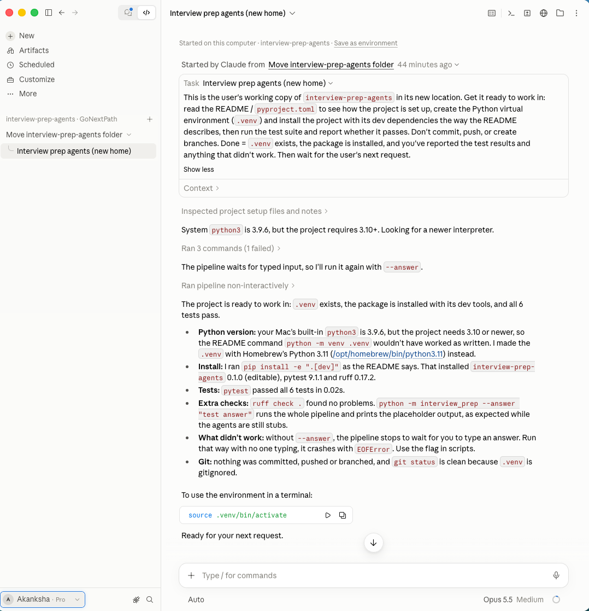
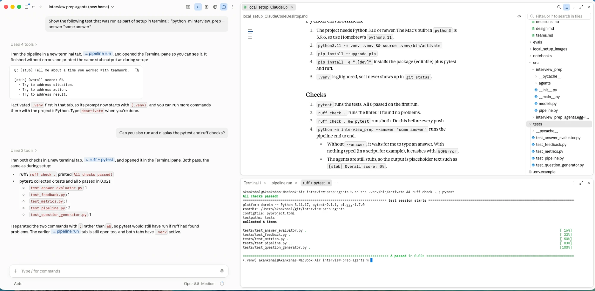
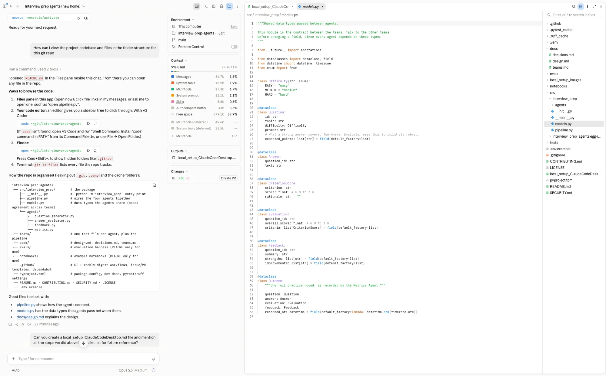

# Local setup (Claude Code Desktop)

## Repo location and AI-driven setup

1. Repo location: `~/git/interview-prep-agents`
2. `origin` (my fork created manually): https://github.com/akankshalonhari/interview-prep-agents
3. `upstream` (the original): https://github.com/GoNextPath/interview-prep-agents
4. Both use HTTPS because there are no SSH keys for GitHub on this Mac, so the first push asks me to sign in.
5. Prompt used once fork and repo folder is created: "I want to use Claude Code on my project, start a new session with ~/git/interview-prep-agents as the folder."

   

## Python environment

1. The project needs Python 3.10 or newer. The Mac's built-in `python3` is 3.9.6, so use Homebrew's `python3.11`.
2. `python3.11 -m venv .venv && source .venv/bin/activate`
3. `pip install --upgrade pip`
4. `pip install -e ".[dev]"` installs the package (editable) plus pytest and ruff.
5. `.venv` is gitignored, so it never shows up in `git status`.

## Checks

1. `pytest` runs the tests. All 6 passed on the first run.
2. `ruff check .` runs the linter. It found no problems.
3. `ruff check . && pytest` runs both. Do this before every push.
4. `python -m interview_prep --answer "some answer"` runs the pipeline end to end.
   - Without `--answer`, it waits for me to type an answer. With nothing typed (in a script, for example), it crashes with `EOFError`.
   - The agents are still stubs, so the output is placeholder text such as `[stub] Overall score: 0%`.

   

## Browsing the code

1. In Claude Code Desktop, use the Files pane beside the chat: click a file link, or ask Claude to open a file.

   

2. VS Code: `code ~/git/interview-prep-agents`
3. Finder: `open ~/git/interview-prep-agents`. Press Cmd+Shift+. to show hidden folders.
4. `git ls-files` lists every file the repo tracks.
5. Good places to start:
   - `src/interview_prep/pipeline.py` shows how the four agents connect.
   - `src/interview_prep/models.py` has the data types the agents share. Agree changes to it with the other teams first.
   - `src/interview_prep/agents/` has one module per agent.
   - `tests/` has one test file per agent, plus the pipeline.
   - `docs/design.md` explains the design.

## Local setup Mac Terminal (Manual)

1. Install Homebrew: `/bin/bash -c "$(curl -fsSL https://raw.githubusercontent.com/Homebrew/install/HEAD/install.sh)"`
2. Put Homebrew on your PATH, now and in every new terminal:
   - `echo >> ~/.zprofile`
   - `echo 'eval "$(/opt/homebrew/bin/brew shellenv zsh)"' >> ~/.zprofile`
   - `eval "$(/opt/homebrew/bin/brew shellenv zsh)"`
   - `brew --version` to check it worked
3. `brew install python@3.11`
4. Clone your fork and add the original as `upstream`:
   - `git clone https://github.com/akankshalonhari/interview-prep-agents.git && cd interview-prep-agents`
   - `git remote add upstream https://github.com/GoNextPath/interview-prep-agents.git`
5. `python3.11 -m venv .venv && source .venv/bin/activate`
6. `pip install --upgrade pip`
7. `pip install -e ".[dev]"`
8. `ruff check . && pytest`
9. From the repo root, with no `cd src`, run `python -m interview_prep --answer "some answer"`. Leave out `--answer` if you want to type the answer yourself.
10. Run `deactivate` when you're finished.
